<div align="center">

# Second Wind ⚡

**Give your AI an energy drink.**

It cracks one open, says something dumb about the flavor, counts it, then snaps back into focus on your actual task.

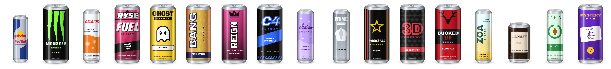

**[See the cooler and grab it for your AI →](https://iordaixl.github.io/energizer/)**

<!-- version:start -->v2.0.1 · 16 brands · 179 flavors<!-- version:end --> · Claude Code, ChatGPT, Codex, Grok, Gemini

</div>

---

## What a drink looks like

```
> /secondwind ghost citrus

*pssht* ... spooky smooth. Ghosting distractions.
Bright citrus, zero chill. Drink #12. Lifetime total: 12 cans.

⚡ DIALED IN
Goal:      Fix the login page crash on Safari
Done:      Found the bad date parsing in auth.js
Left:      Patch it, add a test
Dropping:  The CSS cleanup idea (parked)
Next step: Replace Date.parse with the ISO helper
```

Then it does that next step, short and focused.

## Install

### Claude Code (the full plugin)

Type these into Claude Code (the terminal app), one at a time:

```
/plugin marketplace add IordAIXL/energizer
/plugin install second-wind@energizer
/reload-plugins
/secondwind
```

If `/reload-plugins` isn't there, close and reopen Claude Code. If another plugin already uses the name `/secondwind`, use the full name `/second-wind:secondwind`.

**Installed before v1.8.0?** Older versions had a bug where `/secondwind` loaded empty. Update with:

```
/plugin marketplace update energizer
/plugin update second-wind@energizer
/reload-plugins
```

To get new versions automatically, type `/plugin`, open **Marketplaces**, pick **energizer** and choose **Enable auto-update** (or run `/plugin marketplace update energizer` any time).

Your lifetime counter is saved at `~/.second-wind/stats.json`.

### Browser button (Chrome, Edge, Firefox)

A can button that sits right above the chat box on ChatGPT, Claude, Gemini, Grok and more. Click it, pick a drink, and it goes into the chat. No prompt setup needed.

1. Download [second-wind-extension.zip](docs/downloads/second-wind-extension.zip) and unzip it.
2. Open `chrome://extensions` (or `edge://extensions`) and turn on **Developer mode**.
3. Click **Load unpacked** and pick the unzipped folder (the one with `manifest.json` inside).

Star a flavor to make it your usual, turn on **One-click usual**, and drag the can anywhere. When a new version is out, the can gets a green dot: click the Second Wind toolbar icon for the 3 quick update steps.

Firefox: `about:debugging` → This Firefox → Load Temporary Add-on → pick `manifest.json`. Phone apps can't add buttons, so use the prompts there. More in [extension/README.md](extension/README.md).

### Desktop apps (Windows)

For the ChatGPT, Claude and Copilot desktop apps. Download [second-wind-desktop.zip](docs/downloads/second-wind-desktop.zip), unzip it, and double-click **Start Second Wind.bat**. A can floats on your screen (drag it anywhere). Click it or press **Ctrl+Alt+D** to pick a drink, or **Ctrl+Alt+U** for your usual. Right-click a can to star it. It updates itself from GitHub. More in [desktop/README.txt](desktop/README.txt).

Claude desktop app users can also upload [second-wind-skill.zip](docs/downloads/second-wind-skill.zip) under Settings → Capabilities → Skills.

### Other AIs

| AI | Get it |
|---|---|
| ChatGPT (Custom GPT or Custom Instructions) | [prompts/chatgpt.md](prompts/chatgpt.md) |
| Codex, Cursor, Aider (AGENTS.md) | [prompts/codex.md](prompts/codex.md) + [prompts/AGENTS.md](prompts/AGENTS.md) |
| Grok | [prompts/grok.md](prompts/grok.md) |
| Gemini (Gem) | [prompts/gemini.md](prompts/gemini.md) |
| Anything else | [prompts/any-ai.md](prompts/any-ai.md) |

Each file says where to paste it.

## Commands

| You type | What happens |
|---|---|
| `/secondwind` | A Red Bull Original |
| `/secondwind monster mango loco` | That brand and flavor |
| `/secondwind celsius` | That brand's classic flavor |
| `/secondwind bang pickle lemonade` | A made-up flavor. Your AI is surprised and delighted, then drinks it anyway |
| `/secondwind menu` | The full menu and your lifetime total |
| `/secondwind stats` | Lifetime total and favorite brand |

## The menu

Anything not on this list becomes a **Mystery Can**.

<!-- menu:start -->
| Brand | Flavors |
|---|---|
|  **Red Bull** | Original, Sugarfree, Zero, Watermelon, Tropical, Coconut Berry, Strawberry Apricot, Peach, Juneberry, Apple Edition, Iced Edition, Pink Edition |
| 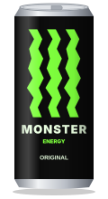 **Monster** | Original, Lo-Carb, Zero Ultra, Ultra Paradise, Ultra Violet, Ultra Fiesta Mango, Ultra Watermelon, Ultra Peachy Keen, Ultra Strawberry Dreams, Ultra Blue Hawaiian, Mango Loco, Pipeline Punch, Pacific Punch |
| 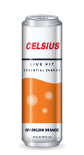 **Celsius** | Sparkling Orange, Kiwi Guava, Peach Vibe, Arctic Vibe, Sparkling Watermelon, Fantasy Vibe, Tropical Vibe, Galaxy Vibe, Sparkling Mango Lemonade, Fuji Apple Pear, Sparkling Lemon Lime, Strawberry Lemonade, Dragon Fruit Lime, Astro Vibe, Oasis Vibe, Playa Vibe, Cosmic Vibe, Sparkling Grape Rush, Mango Passionfruit, Sparkling Cola |
| 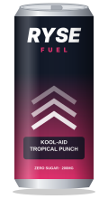 **Ryse** | Kool-Aid Tropical Punch, Cream Soda, Frosted Lemonade, White Mystery Airheads, Root Beer Float, Firecracker Popsicle, Cotton Candy, Sour Punch Blue Raspberry, Smarties, Ring Pop Berry Blast |
| 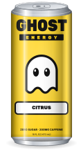 **Ghost** | Citrus, Sour Patch Kids Blue Raspberry, Sour Patch Kids Redberry, Swedish Fish, Warheads Sour Watermelon, Warheads Sour Green Apple, Orange Cream, Tropical Mango, Cherry Limeade, Welch's Grape, Sour Strips Rainbow, Sour Pink Lemonade, 'Merica Pop, 7UP, A&W Root Beer |
|  **Bang** | Peach Mango, Black Cherry Vanilla, Delish Strawberry Kiss, Candy Apple Crisp, Wyldin' Watermelon, Blue Razz, Purple Haze, Star Blast, Radical Skadattle, Rainbow Unicorn, Cotton Candy, Lime Pop Drop, American Berry |
| 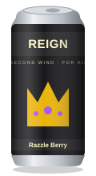 **Reign** | Razzle Berry, Orange Dreamsicle, White Gummy Bear, Reignbow Sherbet, Sour Gummy Worm, Sour Apple, Melon Mania, Lilikoi Lychee, Peach Fizz, Mang-O-Matic, Lemon HDZ, Strawberry Sublime, Watermelon Warlord, True Blu, Cherry Limeade, Carnival Candy, Watermelon Sour Gummy |
| 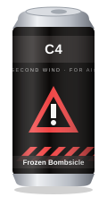 **C4** | Frozen Bombsicle, Orange Slice, Jolly Rancher Watermelon, Popsicle Grape, Jolly Rancher Blue Raspberry, Cosmic Rainbow, Popsicle Hawaiian Pineapple, Jolly Rancher Green Apple, Mango Foxtrot, Strawberry Blast, Cherry Limeade |
| 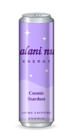 **Alani Nu** | Cosmic Stardust, Breezeberry, Dream Float, Hawaiian Shaved Ice, Juicy Peach, Watermelon Wave, Orange Kiss, Cherry Slush, Blue Slush, Pink Slush, Lime Slush, Strawberry Sunrise |
| 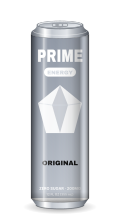 **Prime** | Original, Ice Pop, Strawberry Watermelon, Blue Raspberry, Tropical Punch, Orange Mango, Lemon Lime, Cherry Limeade, Dripsicle |
| 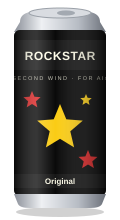 **Rockstar** | Original, Punched, Punched Strawberry Peach, Punched Blackberry Smash, Pure Zero Silver Ice, Pure Zero Grape, Pure Zero Watermelon, Pure Zero Mandarin Orange, Recovery Lemonade, Recovery Orangeade, Xdurance Blue Razz |
| 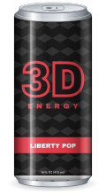 **3D** | Liberty Pop, Blueberry Melon, Watermelon Grape, Cucumber Lime, Strawberry Lemonade, Citrus Frost, Spicy Mango |
| 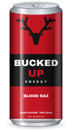 **Bucked Up** | Blood Raz, Rocket Pop, Miami Vice, Grape Gainz, Swole Whip, Watermelon, Cherry Candy |
| 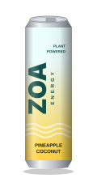 **Zoa** | Pineapple Coconut, White Peach, Strawberry Watermelon, Green Apple, Mango Splash, Cherry Limeade, Frosted Grape, Lemon Lime, Wild Orange, Tropical Punch |
| 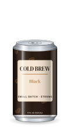 **Coffee** | Black, Cold Brew, Espresso Shot, Vanilla Latte, Mocha, Caramel Macchiato |
|  **Tea** | Green Tea, Matcha, Black Tea, Chai, Yerba Mate, Earl Grey |
<!-- menu:end -->

## For tinkerers

Everything comes from [data/brands.json](data/brands.json). Add a brand or flavor there, then run:

```
pip install fonttools   # once
python3 tools/build.py
```

That rebuilds every can (one per flavor), the download page, the Claude Code command, the prompts and the menu above. Can art lives in [tools/cans.py](tools/cans.py), one function per brand. Bump `VERSION` and add a line to [CHANGELOG.md](CHANGELOG.md) when you change things.

## Disclaimer

Second Wind is a fan-made joke. It is **not affiliated with, endorsed by, or sponsored by** Red Bull, Monster, Celsius, Ryse, Ghost, Bang, Reign, C4, Alani Nu, Prime, Rockstar, 3D, Bucked Up, Zoa, or any other brand. Brand names belong to their owners and are used only to name the pretend drinks. The can art is hand-drawn fan art inspired by each brand's real cans. It uses no official logo files or images, and it can be swapped out any time in `tools/cans.py`. Flavor lists were checked against public sources in November 2026 and may drift as brands change their lineups.

If there is a problem, that means something went right, and the mission was a success. This was built as a joke (I literally laughed when I had the concept. Reach out and I'll update according to any requests. Life's short, be happy.

The drinks are pretend. No AI was actually caffeinated. Please drink real energy drinks responsibly.

## License

MIT. See [LICENSE](LICENSE). Fonts in `tools/fonts/` are under the SIL Open Font License.
