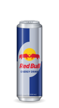
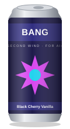
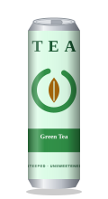
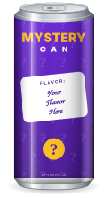

# Second Wind ⚡

**Give your AI an energy drink.** It cracks one open, says something about the flavor, counts it, and then snaps back into focus on your actual task.

Just for fun. Version 1.0.0.

<p align="center">
          
</p>

**See all the cans:** https://iordaixl.github.io/energizer/

## What happens when you give it a drink

```
> /secondwind ghost citrus

*pssht* ... spooky smooth. Ghosting distractions.
Bright citrus, zero chill. Drink #12. Lifetime total: 12 cans.

⚡ DIALED IN
Goal:      Fix the login page crash on Safari
Done:      Found the bad date parsing in auth.js
Left:      Patch it, add a test
Dropping:  The CSS cleanup idea (parked)
Next step: Replace Date.parse with the ISO helper
```

Then it does that next step, short and focused.

## Commands

| You type | What happens |
|---|---|
| `/secondwind` | A Red Bull Original |
| `/secondwind monster mango loco` | That brand and flavor |
| `/secondwind celsius` | That brand's classic flavor |
| `/secondwind bang pickle lemonade` | Made-up flavor? Your AI is surprised and delighted, then drinks it anyway |
| `/secondwind menu` | The full menu and your lifetime total |
| `/secondwind stats` | Lifetime total and favorite brand |

**Brands:** Red Bull, Monster, Celsius, Ryse, Ghost, Bang, Reign, C4, Alani Nu, Prime, Rockstar, 3D, Bucked Up, Zoa, Coffee, Tea. Anything else becomes a Mystery Can.

## Install

### Claude Code (the real plugin)

In Claude Code, run:

```
/plugin marketplace add IordAIXL/energizer
/plugin install second-wind@energizer
```

The lifetime counter is saved at `~/.second-wind/stats.json`.

### Other AIs

| AI | File |
|---|---|
| ChatGPT (Custom GPT or Custom Instructions) | [prompts/chatgpt.md](prompts/chatgpt.md) |
| Codex, Cursor, Aider (AGENTS.md) | [prompts/codex.md](prompts/codex.md) and [prompts/AGENTS.md](prompts/AGENTS.md) |
| Grok | [prompts/grok.md](prompts/grok.md) |
| Gemini (Gem) | [prompts/gemini.md](prompts/gemini.md) |
| Anything else | [prompts/any-ai.md](prompts/any-ai.md) |

Each file says where to paste it.

## For tinkerers

Everything is generated from [data/brands.json](data/brands.json). Add a brand or flavor there, then run:

```
python3 tools/build.py
```

That rebuilds the can art, the download page, the Claude Code command and all the prompts. Bump `VERSION` and add a line to `CHANGELOG.md` when you change things.

## Disclaimer

Second Wind is a fan-made joke. It is **not affiliated with, endorsed by, or sponsored by** Red Bull, Monster, Celsius, Ryse, Ghost, Bang, Reign, C4, Alani Nu, Prime, Rockstar, 3D, Bucked Up, Zoa, or any other brand. Brand names belong to their owners and are used only to name the pretend drinks. The can art is hand-drawn fan art inspired by each brand's real cans. It uses no official logo files or images, and it can be swapped out any time in `tools/cans.py`.

The drinks are pretend. No AI was actually caffeinated. Please drink real energy drinks responsibly.

## License

MIT. See [LICENSE](LICENSE).
